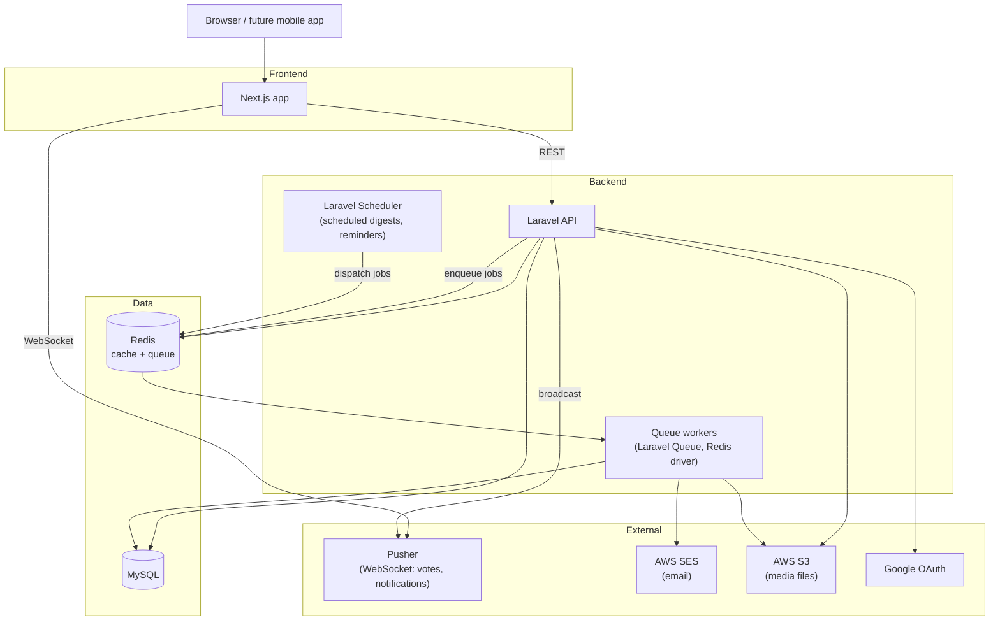

# Launchpad

A site where founders launch new products on a chosen day and people vote on them.
Best products of the day rise to the top. Think "daily list of what launched today."

See the full brief: [`docs/01-client-brief.md`](docs/01-client-brief.md).

## Who's it for

- **Visitors** – browse, no account needed
- **Members** – vote, comment, follow
- **Founders** – members who submitted a product
- **Reviewers** – staff who approve/reject submissions
- **Admins** – staff, full control (accounts, takedowns)

Full feature list: [`docs/02-features.md`](docs/02-features.md).

## Tech stack

**Confirmed:**
- Backend / API — Laravel (PHP)
- Frontend — Next.js (TypeScript)
- Database — MySQL
- Cache / background jobs — Redis (Laravel Queues)
- Real-time updates — Pusher (live vote counts, notification bell)

**Decided, open to revisit:**
- Email — AWS SES (via Laravel Mail, queued through Laravel Queues)

**Suggested additions:**
- File storage — AWS S3 (logos, screenshots, avatars)
- Search — MySQL `FULLTEXT` search first; move to Meilisearch/Elasticsearch if it's not fast enough
- Error tracking — Sentry
- CI — GitHub Actions
- Hosting — Vercel (frontend), AWS ECS/Fargate or Render (backend + workers)
- Containers — Docker for local dev + deploys

Decisions and the reasoning behind them live in
[`docs/03-architecture-decisions.md`](docs/03-architecture-decisions.md).

## Architecture



**Flow in short:**
- Next.js talks to Laravel over REST for normal requests, Pusher (WebSocket) for live updates.
- Laravel writes to MySQL, uses Redis for caching and as the queue backend.
- Slow or "must not be lost" work (emails, digests, export files) goes through Laravel Queues (Redis-backed, monitored with Horizon) to queue workers, not the request/response cycle.
- Media files go to S3, not the app server.

## Repo layout

```
launchpad/
├── launchpad-backend/     # Laravel
├── launchpad-frontend/    # Next.js
├── docs/                  # brief, features, decisions, db schema
├── AGENTS.md              # conventions any coding agent should follow
└── CLAUDE.md              # Claude-specific notes, points to AGENTS.md
```

## Docs

- [`docs/01-client-brief.md`](docs/01-client-brief.md) – original client brief
- [`docs/02-features.md`](docs/02-features.md) – features by user role
- [`docs/03-architecture-decisions.md`](docs/03-architecture-decisions.md) – ADR log, kept up to date as we build
- [`docs/04-db-diagram.md`](docs/04-db-diagram.md) – DBML schema

## Getting started

Needs MySQL and Redis running locally (or point `DB_HOST`/`DB_DATABASE`/etc. and
`REDIS_HOST` in `.env` at wherever they're running).

### Backend

```bash
cd launchpad-backend
composer install
cp .env.example .env
php artisan key:generate
php artisan migrate
php artisan serve
```

Run a queue worker alongside it for background jobs (email, digests, exports):

```bash
php artisan queue:work
```

Runs on Laravel 13, PHP 8.3+.

### Frontend

```bash
cd launchpad-frontend
npm install
cp .env.example .env.local
npm run dev
```

Runs on Next.js 16 (TypeScript, App Router, Tailwind).
